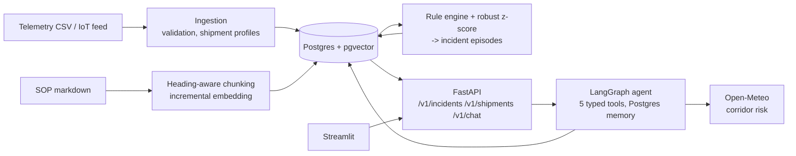

# Cold-Chain Ops Assistant

Decision support for a refrigerated logistics fleet. A deterministic SOP rule engine turns raw IoT telemetry into a small queue of excursion incidents. An LLM agent then explains them, checks live weather on the route, and cites the exact SOP clause behind every recommended action.



## Design decisions

- **Detection is code, not prompting.** SOP thresholds are compliance rules, so `domain/rules.py` evaluates them deterministically and unit-tests every boundary. The LLM explains alerts; it never has to "spot" a 4.1 °C reading in a table.
- **Incidents, not alerts.** Consecutive violations of one rule collapse into one episode with a start, end, peak and duration. An incident stays open only while the shipment's latest reading still violates the rule. On the sample data this turns ~74k per-reading alerts into 440 open incidents. Acknowledgements survive re-runs of the detector.
- **No LLM-written SQL.** The old version let the model run free-form T-SQL, guarded only by `startswith("SELECT")`. Every tool now maps to a parameterised repository function with a bounded result size.
- **Hybrid retrieval.** pgvector cosine plus Postgres full-text, fused with Reciprocal Rank Fusion in a single query. SOP questions mix meaning with exact tokens (`0.65`, `Tier 2`), and this handles both.
- **One storage engine.** Telemetry, incidents, vectors and agent conversation memory all live in Postgres, which means one backup, one connection pool and one thing to operate.
- **Degrades instead of dying.** With no LLM key the API still serves the incident and fleet endpoints, and chat returns 503. Tool failures come back to the model as structured errors, and agent loops are capped by a step budget.

## Quickstart

```bash
cp .env.example .env            # add COLDCHAIN_LLM_API_KEY for the assistant
docker compose up --build       # db -> seed -> api (:8000/docs) -> ui (:8501)
```

Local without Docker (needs Postgres 16 with pgvector):

```bash
make install && coldchain seed && make api   # and `make ui` in another shell
```

`coldchain seed` runs the migrations, loads 32k readings, indexes the SOPs and runs detection in about 20 s.

## API

| Method | Path | |
|---|---|---|
| GET | `/v1/fleet/summary` | shipments by profile and risk, open incidents by rule and severity |
| GET | `/v1/incidents` | filter by `severity`, `rule_id`, `shipment_id`, `status`; sorted most severe first |
| POST | `/v1/incidents/{id}/ack` | acknowledge an incident |
| GET | `/v1/shipments/{id}` | profile, latest reading, 24-reading trend, open and resolved incidents |
| GET | `/v1/sop/search?q=` | hybrid SOP search with citations |
| POST | `/v1/chat` | agent answer and this turn's tool trace; pass `thread_id` to continue a conversation |
| POST | `/v1/chat/stream` | the same over SSE (`tool_call`, `tool_result`, `answer`) |
| GET | `/healthz` `/readyz` `/metrics` | liveness, DB readiness, Prometheus metrics |

Auth uses the `X-API-Key` header. `COLDCHAIN_ENV=prod` refuses to start without keys. Every response carries an `X-Request-ID`, and logs are JSON lines bound to that ID.

## Quality gates

- `pytest`: 51 tests. Unit tests cover the rules, episodes, anomalies, chunking and weather scoring. Integration tests run against real Postgres and cover the repository, detection idempotency, retrieval, every endpoint, auth, and the full agent loop with a scripted LLM, so no API key is needed.
- `python evals/run_evals.py retrieval`: Hit@1 / Hit@3 / MRR on a golden set. It runs in CI with an offline embedder and fails the build below 0.8 Hit@1 (currently 0.92 / 1.0 / 0.96).
- `python evals/run_evals.py agent`: tool selection and grounding checks for the real model. Use it when you change the prompt or model.
- CI runs ruff, the tests with coverage, the eval gate and Docker builds. Tagging `v*.*.*` publishes API and UI images to GHCR.

## Layout

```
src/coldchain/
  config.py          typed settings (COLDCHAIN_*)
  db/                models, session, read-side repository
  domain/            rules.py (SOP as code), detection.py, weather.py
  ingestion/         telemetry CSV, SOP indexing
  rag/               chunking, embedders, hybrid retriever
  agent/             tools, prompt, LangGraph graph, LLM factory
  api/               FastAPI app, routes, auth, metrics
ui/app.py            Streamlit thin client (API only, no DB or LLM credentials)
migrations/          Alembic
evals/               golden sets and runner
```

## Data notes

The telemetry comes from the [Kaggle logistics dataset](https://www.kaggle.com/datasets/datasetengineer/logistics-and-supply-chain-dataset). It has no shipment ID or product type, so consecutive readings are grouped into 128-hour trips, and each trip's cargo profile (fresh or frozen) is inferred from its median temperature. Every trip comes out frozen, which is why SOP v2.5 adds a frozen-goods band (at or below −5 °C) next to the original fresh 0–4 °C band. In production both would come from the TMS booking record.

LLM providers: OpenAI, DeepSeek or Ollama, all through the OpenAI-compatible API (`COLDCHAIN_LLM_PROVIDER`).
